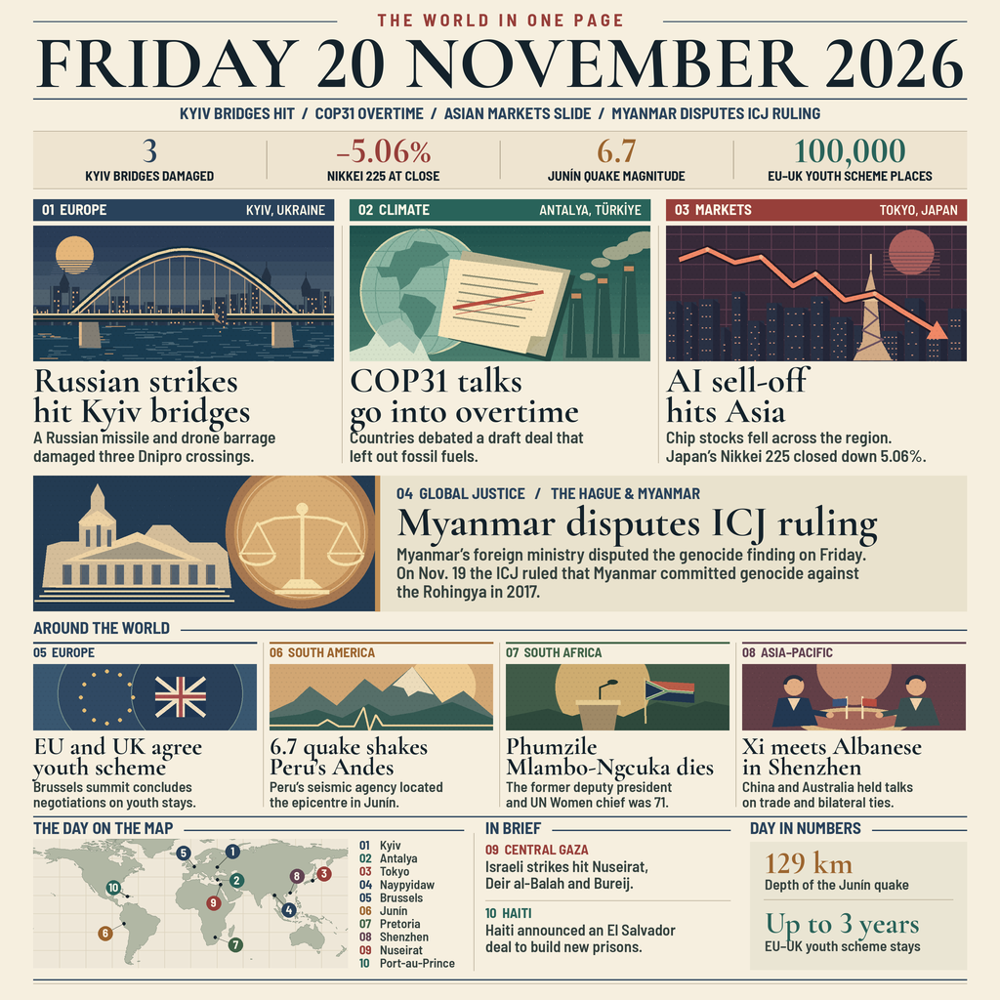

# The World in One Page

[](https://make.fun/bounty/news-image-20261120)
[](https://make.fun/bounty/news-image-20261120)
[](https://make.fun/bounty/news-image-20261120)

A newspaper front page for **Friday 20 November 2026**, made for the [make.fun world news bounty](https://make.fun/bounty/news-image-20261120).



## Story and source notes

Dates below refer to the local date of each development. The numbered map locates each story by its event site or a representative city.

| Story | Confirmed development and figures | Illustration or placement | Sources |
| --- | --- | --- | --- |
| 01. Russian strikes hit Kyiv bridges | Overnight into **20 Nov**, a Russian missile and drone attack damaged **three** bridges across the Dnipro in Kyiv. | Steel arches, city lights, and a damaged span | [The Kyiv Independent](https://kyivindependent.com/russia-launches-mass-missile-attack-against-ukraine-after-putin-vows-revenge/) |
| 02. COP31 talks go into overtime | On **20 Nov**, negotiations in Antalya ran past the scheduled end while countries disputed a draft that omitted fossil fuels. | Globe, smokestacks, and marked-up draft | [The Guardian](https://www.theguardian.com/environment/2026/nov/20/cop31-talks-overtime-fossil-fuels-vanish-from-draft-deal) |
| 03. AI sell-off hits Asia | On **20 Nov**, Asian chip and technology shares fell amid concerns about AI valuations. The Nikkei 225 closed **5.06% lower**. | Tokyo skyline with a symbolic falling market line | [Reuters](https://za.investing.com/news/economy-news/asian-shares-head-for-worst-week-since-2020-as-ai-trade-gloom-fails-to-abate-4587666), [Jiji Press](https://jen.jiji.com/business/markets/2026112000935/) |
| 04. Myanmar disputes ICJ ruling | On **20 Nov**, Myanmar's foreign ministry disputed the findings of the ICJ's **19 Nov** judgment. The court found that Myanmar committed genocide against the Rohingya during the **2017** clearance operations in northern Rakhine State. | Courthouse and scales | [United Nations](https://dppa.un.org/en/node/137591), [Myanmar's statement](https://www.mofa.gov.mm/en/press-statement-by-the-ministry-of-foreign-affairs-of-the-republic-of-the-union-of-myanmar-on-the-judgment-of-the-international-court-of-justice-delivered-on-19-november-2026/) |
| 05. EU and UK agree youth scheme | At the Brussels summit on **20 Nov**, the EU and UK announced the conclusion of talks on a youth experience scheme covering **100,000** young people and stays of up to **three years**. | EU stars and the UK flag | [European Council](https://www.consilium.europa.eu/en/meetings/international-summit/2026/11/20/), [UK–EU joint statement](https://www.gov.uk/government/publications/ukeu-summit-2026-key-documents/uk-eu-summit-2026-joint-statement-html) |
| 06. 6.7 quake shakes Peru's Andes | Late on **20 Nov** in Peru, a **magnitude 6.7** earthquake struck Junín at **129 km** depth, according to Peru's seismic bulletin. This was **21 Nov UTC**. | Andes ridgeline and symbolic seismograph trace | [Peru's national seismic bulletin](https://portal.indeci.gob.pe/wp-content/uploads/2026/11/BOLET%C3%8DN-INFORMATIVO-S%C3%8DSMICO-NACIONAL-N%C2%BA-818-2026-del-20-de-noviembre-de-2026.pdf), [Associated Press](https://apnews.com/article/d9c0a1de6be970d6a5a36993c607f29f) |
| 07. Phumzile Mlambo-Ngcuka dies | On **20 Nov**, South Africa announced the death of its former deputy president and former UN Women executive director. She was **71**. | Lectern and South African flag | [South African presidency](https://thepresidency.gov.za/presidencys-announcement-passing-former-deputy-president-phumzile-mlambo-ngcuka), [Associated Press](https://apnews.com/article/ce72144fd0991768e9cb466daa95dfe5) |
| 08. Xi meets Albanese in Shenzhen | Chinese President Xi Jinping met Australian Prime Minister Anthony Albanese on **20 Nov** in Shenzhen. The governments discussed bilateral ties, including economic and trade cooperation. | Delegates and flags at a roundtable | [Australian prime minister's office](https://www.pm.gov.au/media/statement-joint-outcomes-australia-china-annual-leaders-meeting-0), [China's foreign ministry](https://www.mfa.gov.cn/mfa_eng./xw/zyxw/202611/t20261120_12063986.html) |
| 09. Strikes hit central Gaza | On **20 Nov**, Israeli strikes hit Nuseirat, Deir al-Balah, and Bureij. | Brief and map pin at Nuseirat | [Associated Press](https://apnews.com/article/16c39c487a23b53b73c5eabb7f0fd57a), [Al Jazeera](https://www.aljazeera.com/news/2026/11/20/israeli-drone-attacks-kill-seven-palestinians-in-central-gaza) |
| 10. Haiti announces prison deal | Haiti announced a deal with El Salvador to build new prisons on **20 Nov**. | Brief and map pin at Port-au-Prince | [Associated Press](https://apnews.com/article/c3192c1276fd235b727666a05062db00) |

## Artwork and review

The front page uses an ivory ground, newspaper rules, a large Cormorant Garamond dateline, and Barlow Semi Condensed for captions and labels. Four verified figures sit above three illustrated leads. A wide justice feature separates them from four shorter illustrated stories. A world map, two briefs, and a fact box close the page. The review covered the full 1024-pixel export and previews at 512 and 256 pixels.

[The layout](artwork/render.py), [lead illustrations](artwork/lead_scenes.py), and [smaller scenes](artwork/scenes.py) are drawn and typeset in Pillow using geometric shapes, fine rules, and a staggered halftone screen. The locator map uses [Natural Earth's public-domain 1:110m land data](https://www.naturalearthdata.com/downloads/110m-physical-vectors/). Font notices are in [artwork/fonts](artwork/fonts). The illustrations represent the stories editorially. The stock and earthquake traces are symbolic.

## Run offline

Use Node.js 22. The standard-library entrypoint validates the saved artwork's PNG header, dimensions, and size, then writes the same bytes to `/output/entry.png`. It uses no network, packages, fonts, or credentials at runtime.

```sh
MAKEFUN_OUTPUT_DIR=out node main.ts
```

The single output is a 1024 × 1024 RGB PNG under 1 MiB. Two fresh, network-disabled Node 22.23.4 runs must match byte for byte.

To re-render the source locally, use Python with Pillow 13.0.0 and RAQM support. The fonts and map data are included.

```sh
python3 artwork/render.py
```

The code and original artwork are licensed under MIT. The bundled typefaces retain their SIL Open Font Licenses.
