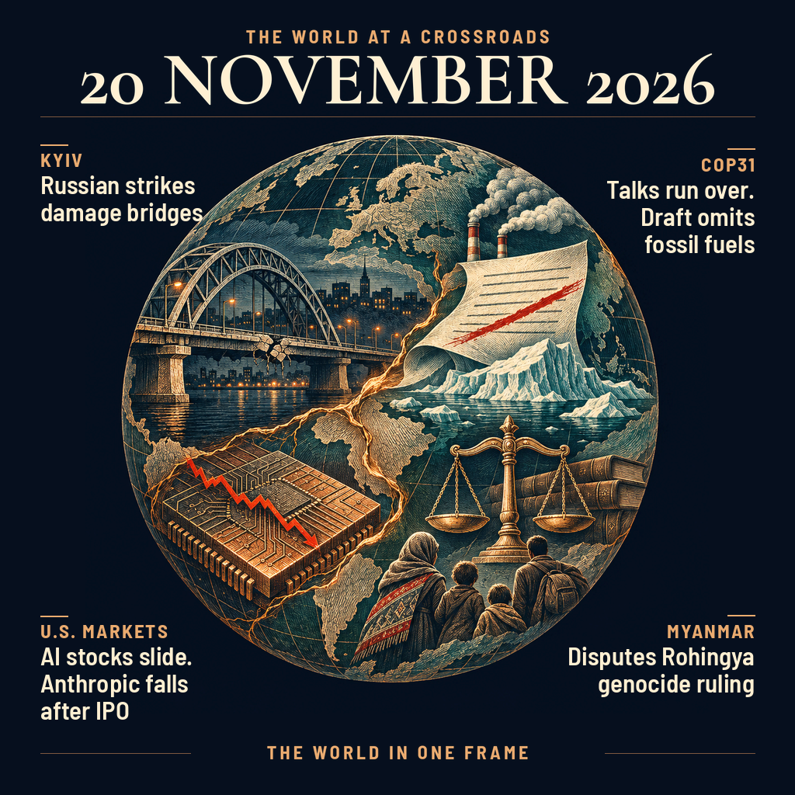

# The World at a Crossroads

[](https://make.fun/bounty/news-image-20261120)
[](https://make.fun/bounty/news-image-20261120)
[](https://make.fun/bounty/news-image-20261120)

A single editorial cover for Friday, 20 November 2026, made for the [make.fun world news bounty](https://make.fun/bounty/news-image-20261120).



## The day's news

- **Kyiv.** Russian strikes damaged three crossings of the Dnipro in an overnight attack that continued into Friday. The bridge in the cover represents those damaged crossings. [The Kyiv Independent](https://kyivindependent.com/russia-launches-mass-missile-attack-against-ukraine-after-putin-vows-revenge/)
- **Antalya.** COP31 talks ran into overtime on Friday, with countries still disputing a draft that omitted fossil fuels. [The Guardian](https://www.theguardian.com/environment/2026/nov/20/cop31-talks-overtime-fossil-fuels-vanish-from-draft-deal)
- **U.S. markets.** The tech sell-off deepened on Friday. Anthropic shares fell the day after the company's stock market debut. The line on the chip is a symbolic falling trend. [Al Jazeera](https://www.aljazeera.com/economy/2026/11/20/us-tech-sell-off-continues-as-anthropic-tumbles-after-mega-ipo) · [Reuters](https://www.lse.co.uk/news/ANT.US/global-markets-tech-leads-global-stocks-rout-treasury-yields-fall-whpwhcgftnu8g1y.html)
- **Myanmar.** Myanmar's foreign ministry disputed the International Court of Justice's finding on Friday. The court delivered its judgment on 19 November and found that Myanmar committed genocide against the Rohingya during the 2017 clearance operations in northern Rakhine State. [Associated Press](https://apnews.com/article/a54d52619bb04ed5ac08e8a07e2e374c) · [United Nations](https://dppa.un.org/en/node/137591) · [Myanmar's statement](https://www.mofa.gov.mm/en/press-statement-by-the-ministry-of-foreign-affairs-of-the-republic-of-the-union-of-myanmar-on-the-judgment-of-the-international-court-of-justice-delivered-on-19-november-2026/)

## Art direction

A copper fault line crosses an engraved atlas globe. A damaged bridge, marked-up climate draft, silicon chip, and scales of justice become parts of the same object. The family below the scales evokes the Rohingya people affected by the judgment. The scenes are editorial illustrations.

Codex used OpenAI's built-in image generation tool to create the original text-free plate. The date and captions were set separately in Cormorant Garamond and Barlow Semi Condensed using Pillow, then flattened into `entry.png`. The repository carries the finished cover and the standard-library runner. The illustration, type, and color are already baked into the image.

## Run offline

Use Node.js 22. The grader writes one 1024 × 1024 PNG to `/output/entry.png`. For a local run, choose a writable directory:

```sh
MAKEFUN_OUTPUT_DIR=out node main.ts
```

The program copies the cover byte for byte. It uses no dependencies, credentials, or network access. The code and artwork are supplied under the MIT license.
